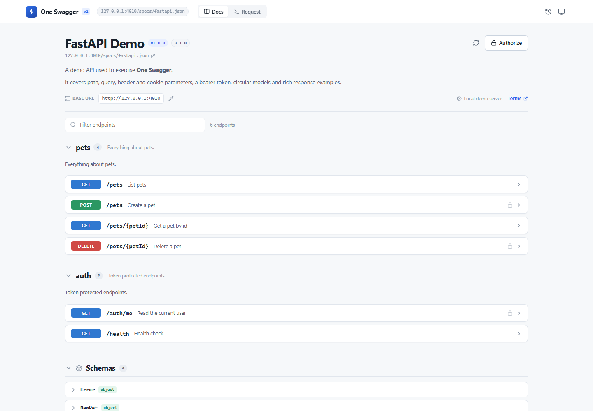
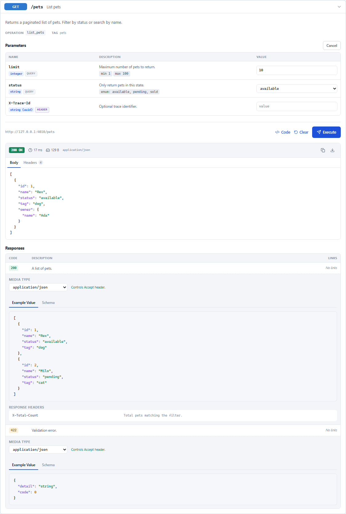
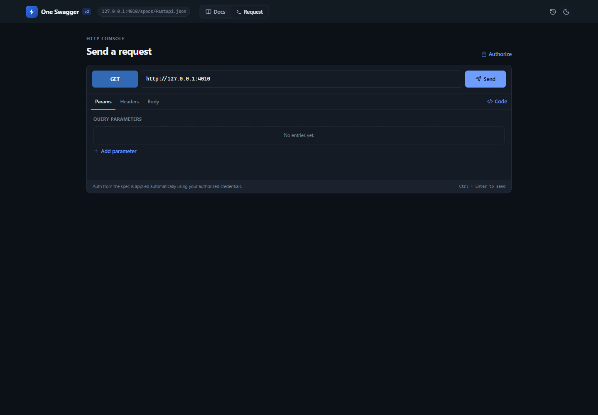
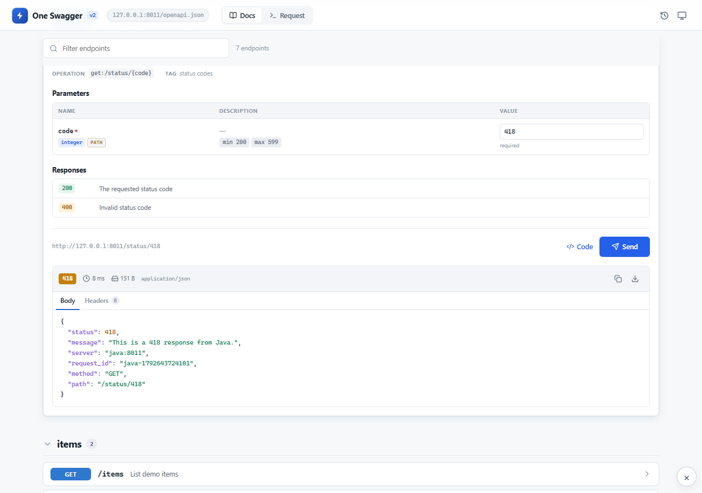

# One Swagger

**Read the docs. Send the request.** A clean Swagger UI / FastAPI-style explorer for any OpenAPI document, with a full API console built into the same page.

One Swagger is a drop-in replacement for the documentation *and* the request runner. Load an OpenAPI 2.0, 3.0 or 3.1 document, browse it like Swagger UI, then execute endpoints inline — with no page switching and no login. The Chrome extension and Tampermonkey userscript add a zero-CORS transport for localhost and APIs that do not send CORS headers.



## Why it exists

Swagger UI is excellent at reading docs. Postman is excellent at sending requests. One Swagger does both in one quiet interface:

- The docs page stays close to Swagger UI / `/docs`: tags, method-tinted endpoint cards, parameters, schemas and responses.
- The **Send** button lives inside the endpoint that it calls. There is no separate collection to configure first.
- The **Request** tab is a free-form HTTP console for anything not in the spec.
- The **Chrome extension** proxies requests through a Manifest V3 service worker, so requests are not blocked by CORS.

## Features

### Specifications
- OpenAPI **3.1**, **3.0** and Swagger **2.0** (converted to the same internal model).
- JSON and YAML, loaded from a URL, dragged/dropped file, file picker or pasted text.
- Recursive `$ref` resolution, circular schemas, `allOf` / `oneOf` / `anyOf`, examples, defaults and enums.
- Relative server URLs and server variables.
- Schema browser with nested model expansion.

### Documentation
- Tag sections, endpoint descriptions, operation metadata and Markdown.
- Endpoint filter across paths, summaries, descriptions, operation IDs and methods.
- Parameter table for path, query, header and cookie parameters.
- Request-body editor with content-type switching, schema view, format and reset-to-example.
- Response documentation for every declared status.
- Server/base-URL switcher and editable base URL.

### Request execution
- Send any documented operation inline, or use the free-form Request console.
- Path, query, header and cookie parameters.
- JSON, `application/x-www-form-urlencoded`, `multipart/form-data` (text fields) and plain-text bodies.
- Auth: HTTP Bearer, HTTP Basic, API key (header/query/cookie), OAuth 2.0 token exchange and OpenID Connect tokens.
- OAuth token exchange also uses the zero-CORS transport.
- Response status, latency, size, content type, body viewer, headers, copy and download.
- Required parameter validation and client-side JSON validation before sending.
- Request history with date grouping, replay, delete, clear and JSON export.
- Code generation in 11 targets: cURL, JavaScript `fetch`, Axios, Python, Go, PHP, Ruby, Java, C#, HTTPie and PowerShell.
- Light/dark/system themes, responsive layout and `Ctrl/Cmd + Enter` to send.
- Local persistence for theme, recent specs, composer drafts, credentials and history.

### Browser surfaces
- **Chrome extension:** full-tab experience opened by the toolbar button. A Manifest V3 service worker proxies API traffic and spec loading without CORS restrictions. Optional side-panel build target.
- **Tampermonkey userscript:** injects the same app into a shadow root on any page. `GM_xmlhttpRequest` provides the zero-CORS transport, and specs are auto-detected on Swagger UI / FastAPI `/docs` pages.
- No remote code, analytics or external service. Requests go only to the URL you choose.

## Screenshots

| Run an endpoint | Request console |
| --- | --- |
|  |  |

More in [`screenshots/`](screenshots/) and ready-to-upload Chrome Web Store assets in [`store-assets/`](store-assets/).

## Quick start

```bash
npm install
npm run dev
```

Open the URL printed by Vite (normally `http://127.0.0.1:5173`) and enter a spec URL such as `http://127.0.0.1:8000/openapi.json`.

### Production build

```bash
npm run build
npm run preview
```

The web build is in `dist/`. The same folder is also a loadable Chrome extension.

## Install the Chrome extension

### Load unpacked (development)

1. Run `npm run build`.
2. Open `chrome://extensions/`.
3. Enable **Developer mode**.
4. Click **Load unpacked** and select the `dist` folder.
5. Pin **One Swagger** and click its toolbar icon.

### Package for the Chrome Web Store

```bash
npm run package:extension
```

This writes `one-swagger-extension.zip` (manifest at the archive root) and `dist/` for local testing. Upload the zip in the Chrome Web Store developer dashboard. See [`STORE_LISTING.md`](STORE_LISTING.md) for listing copy, permission justifications and asset sizes, and [`PRIVACY.md`](PRIVACY.md) for the privacy policy.

### Store assets

```bash
npm run store:assets
```

The five 1280×800 screenshots are generated by the Playwright suite. The 440×280 promo tile and 1400×560 marquee are generated by the script above.

## Install the Tampermonkey userscript

The userscript is a single self-contained file: the React app, styles and OpenAPI engine are all inside it. It does not need the extension or a hosted web app.



1. Install [Tampermonkey](https://www.tampermonkey.net/) in Chrome, Edge, Firefox or Safari.
2. Open the install URL:

   <https://raw.githubusercontent.com/anikethana21/one-swagger-v2/main/one-swagger.user.js>

3. Tampermonkey shows the install screen. Click **Install**.
4. Open an API docs page, or any page where you want to test an API. Click the floating **One Swagger** button in the bottom-right corner, or press **Alt+Shift+S**.
5. If the page is Swagger UI, Redoc, FastAPI `/docs` or another page with a discoverable spec link, the spec loads automatically. Otherwise paste a spec URL on the landing screen.

Press **Esc** or the **Close** button to dismiss the overlay. The app stays mounted, so reopening it keeps the current spec, response and history.

Build and test the userscript locally:

```bash
npm run build:userscript   # writes one-swagger.user.js
npm run test:userscript    # real Chromium + GM bridge + no-CORS request
```

The userscript uses `GM_xmlhttpRequest` for zero-CORS requests and Tampermonkey storage for theme, recent specs, credentials and history across sites. It also works when a page's own CSP would block an injected iframe, because the app runs in a shadow root rather than a nested document.

## Demo APIs

Two runnable examples make status-code testing easy:

| Demo | Docs | Port |
| --- | --- | --- |
| FastAPI | <http://127.0.0.1:8010/docs> | 8010 |
| Java standard library | <http://127.0.0.1:8011/docs> | 8011 |

Both expose `GET /status/{code}` for **200, 201, 202, 204, 301, 400, 401, 403, 404, 409, 418, 422, 429, 500, 502, 503**, plus `/codes`, `/items`, `/secure` and `/echo`.

```bash
# FastAPI
cd demos/fastapi
python -m uvicorn main:app --host 127.0.0.1 --port 8010

# Java
javac -encoding UTF-8 -d demos/java/bin demos/java/OneSwaggerJavaDemo.java
java -cp demos/java/bin OneSwaggerJavaDemo 8011

# Verify both languages and both UI flows
npm run test:demos
```

See [`demos/README.md`](demos/README.md) for details.

## How zero-CORS works

A normal browser tab can only read a response when the API allows the page origin via CORS. The extension does not have that restriction:

1. The app calls `chrome.runtime.sendMessage({ type: 'FETCH_PROXY', ... })`.
2. `background/service-worker.js` performs `fetch()` with the user's method, headers and body.
3. The service worker returns the status, headers, body and timing to the app.

The same route is used for spec documents and OAuth token requests. The userscript has an equivalent path: `GM_xmlhttpRequest` performs the request outside the page's CORS sandbox, and the app receives the status, headers, body and timing. In the web build, One Swagger first tries a direct `fetch()`, then the Vite development proxy (`npm run dev`). A clear CORS explanation is shown if none of these paths can reach the API.

## Supported frameworks

The parser and UI are framework-agnostic. The test suite renders captured specs from every major OpenAPI generator and includes live FastAPI and Java demo APIs:

| Framework | Fixture | Coverage |
| --- | --- | --- |
| FastAPI | `fastapi.json` | OpenAPI 3.1, tags, bearer auth, circular models |
| Express | `express.yaml` | OpenAPI 3.0 YAML |
| Spring Boot | `spring.json` | OpenAPI 3.0.1, `allOf` |
| Flask | `flask.json` | OpenAPI 3.0.2 |
| Django REST Framework | `django.yaml` | OpenAPI 3.0 YAML |
| NestJS | `nestjs.json` | OpenAPI 3.0, DTO schemas |
| ASP.NET Core | `aspnet.json` | OpenAPI 3.0.1 |
| Go | `go.json` | Swagger 2.0 conversion |
| Edge cases | `edge.json` | circular refs, unusual methods and schemas |

These are assertions on titles, operation counts, version badges and schema rendering, plus execution/auth/history/theme flows in the browser. Live execution is verified against the FastAPI demo and the dependency-free Java demo, including every status code and a `418` round trip through the userscript UI.

Go, .NET, Maven/Gradle, PHP and Django were not available as local runtimes in the build environment, so their compatibility is fixture-based. The specs are realistic captured output, not hand-written minimal stubs.

## Development

```bash
npm run dev              # Vite dev server + CORS proxy
npm run api              # Mock API on http://127.0.0.1:4010
npm test                 # Vitest unit tests
npm run test:e2e         # Playwright browser tests
npm run test:extension   # Real Chromium MV3 + zero-CORS smoke test
npm run test:userscript  # Tampermonkey bundle + GM bridge smoke test
npm run test:demos       # FastAPI and Java demo APIs + userscript UI
npm run build:userscript # Generate one-swagger.user.js
npm run test:all         # unit + web/userscript builds + e2e + extension + userscript
npm run fixtures         # Regenerate framework fixtures
```

The tests use Node's built-in HTTP server, Playwright Chromium and Vitest. `npm run test:e2e` starts the mock API automatically; the extension and userscript tests start it if it is not already running. `npm run test:demos` starts the FastAPI and Java demos when they are not already running.

### Project layout

```
src/
  components/        docs, composer, auth, history, response and schema UI
  lib/
    spec/            parsing, Swagger 2 conversion, $ref resolution, examples
    request.ts       request building and operation preparation
    transport.ts     direct fetch, dev proxy, extension and userscript transport
    gm.ts            userscript bridge detection and storage helpers
    auth.ts          credential application and OAuth token exchange
    codegen.ts       code generation for 11 targets
    storage.ts       local/Tampermonkey persistence
  state/AppContext.tsx
  userscript-entry.tsx  shadow-root entry point for the userscript bundle
extension/background.js   MV3 service worker
demos/                    live FastAPI and Java status-code APIs
tests/api/                mock API and framework fixtures
tests/unit/               parser, request, auth, bridge and codegen tests
e2e/                      browser coverage and screenshot generation
scripts/                  extension/userscript/demo smoke tests, packaging, assets
one-swagger.user.js       generated Tampermonkey bundle
```

## Security and privacy

- No account, backend or analytics.
- Credentials, history, theme and drafts are stored in the browser's local storage for the current profile.
- Requests are sent directly to the API URL you enter, or through the extension service worker / userscript `GM_xmlhttpRequest` when those surfaces are installed.
- The extension requests `<all_urls>` and the userscript runs on all sites because the user chooses arbitrary API and spec URLs. Neither collects or transmits browsing data.
- Always review a spec before authorizing it. Treat tokens as secrets.

Read [`PRIVACY.md`](PRIVACY.md) for the full policy.

## License

MIT. See [`LICENSE`](LICENSE).
